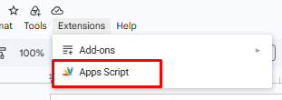
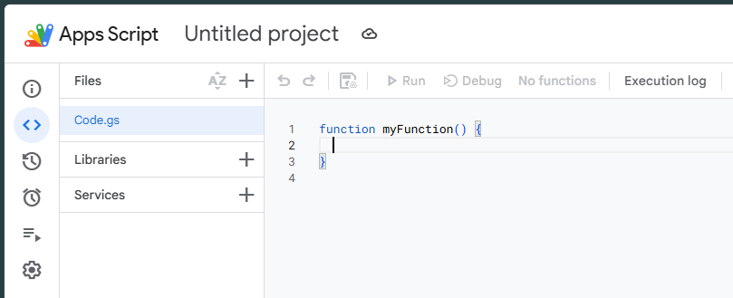
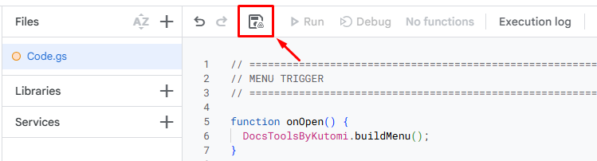
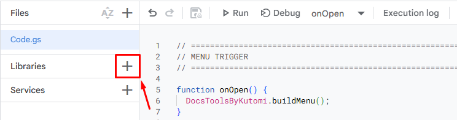
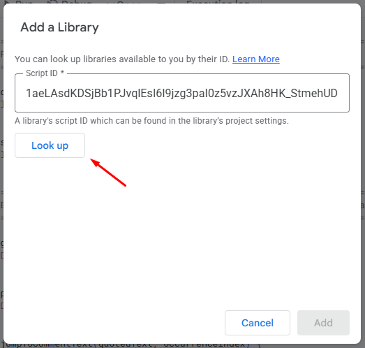
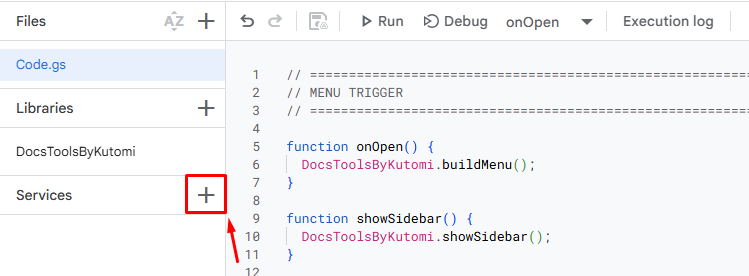
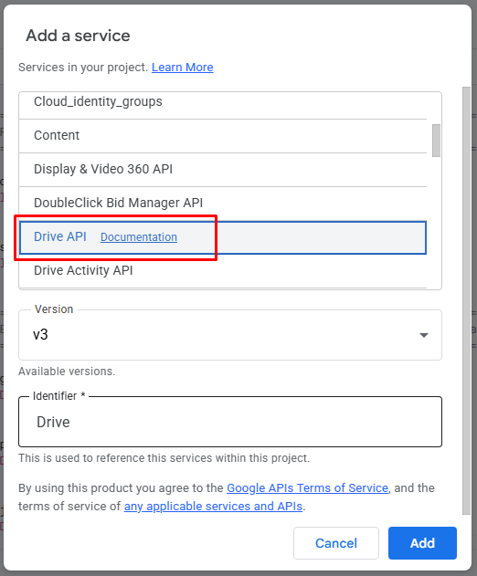
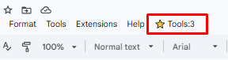

# ⭐ Google Docs Tools by Kutomi

## 🤔 What is this?
This project is a collection of Google Apps Script tools for Google Docs. Each tool adds a custom menu and sidebar directly inside your document, giving you extra functionality without ever leaving Google Docs.

The first available tool is a **Citation Extractor** that reads comments from your document, detects DOI or URL references, resolves them to citation data, and formats them into clean APA-style references — all from a sidebar inside your document.

More tools may be added over time.

The project is split into:
- a reusable **library** project containing the actual logic
- a small **usage** project that connects the library to your document and adds the menu entry

---

## ❔ How to use

These steps walk you through setting up the tool in a Google Docs document from scratch. No programming experience is needed.

### Step 1 — Open your Google Docs document

Open the Google Docs file where you want to use the tool.

### Step 2 — Open the Apps Script editor

In the top menu bar of Google Docs, click **Extensions**, then click **Apps Script**.



> This will open a new browser tab with the Google Apps Script editor — a page where you can attach small programs to your document.

### Step 3 — Clear the default code and paste the script

You will see a code editor with some default placeholder text (usually something like `function myFunction() {}`).



**Select all of it and delete it**, then paste the following code exactly as shown:

```javascript
// =============================================================================
// MENU TRIGGER
// =============================================================================

function onOpen() {
  DocsToolsByKutomi.buildMenu();
}

function showSidebar() {
  DocsToolsByKutomi.showSidebar();
}

// =============================================================================
// FRONT-END DELEGATES (Passes google.script.run calls directly to the library)
// =============================================================================

function getDocumentComments() {
  return DocsToolsByKutomi.getDocumentComments();
}

function processCommentBatch(batch) {
  return DocsToolsByKutomi.processCommentBatch(batch);
}

function jumpToCommentText(quotedText, occurrenceIndex) {
  return DocsToolsByKutomi.jumpToCommentText(quotedText, occurrenceIndex);
}
```

### Step 4 — Save the script

Save the project by pressing **Ctrl + S** on Windows, or **Cmd + S** on Mac.



You may be prompted to give the project a name — you can name it anything you like, for example `Docs Tools`.

### Step 5 — Add the library

The tool relies on a shared library. You need to link it to your project:

1. In the left sidebar of the Apps Script editor, look for the **Libraries** section and click the **+** (plus) button next to it.


2. A dialog will appear asking for a **Script ID**. Paste the following ID exactly:
   ```
   1aeLAsdKDSjBb1PJvqlEsI6l9jzg3paI0z5vzJXAh8HK_StmehUD2-iNl
   ```
3. Click **Look up**.


4. Leave the version on the latest available option.
5. In the **Identifier** field, type exactly:
   ```
   DocsToolsByKutomi
   ```
   *(This name must match exactly — it is case-sensitive.)*
6. Click **Add**.

### Step 6 — Enable the Drive API under Services

The tool uses Google Drive to read comments from your document. You need to enable this access explicitly:

1. In the left sidebar of the Apps Script editor, look for the **Services** section and click the **+** (plus) button next to it.


2. Scroll through the list and find **Google Drive API** or **Drive API**.


3. Select it and click **Add**.

> This tells Google that your script project is allowed to call the Drive API. Without this step, the tool will not be able to read your document's comments.

### Step 7 — Save again

Press **Ctrl + S** (Windows) or **Cmd + S** (Mac) once more to make sure everything is saved.

### Step 8 — Go back to your document and reload it

Switch back to your Google Docs tab and **reload the page** (press **F5** on Windows, or **Cmd + R** on Mac).

After the page reloads, you should see a new menu item called **⭐ Tools:3** appear in the document's top menu bar.

### Step 9 — Run the tool

Click **⭐ Tools:3** in the top menu, then click **📃 Citation Extractor**.



The sidebar will open and begin loading comments from your document.

---

## 🚨 Google warning when authorizing the app

The first time you run the tool, Google will ask for your permission and may show a warning screen saying **"This app isn't verified"** or **"Google hasn't verified this app."**

This is completely normal for custom Apps Script projects that are not published in the Google Marketplace. Here is what to do:

1. Click **Advanced** (shown as a small link near the bottom of the warning screen).
2. Click **Go to [App Name] (unsafe)** or **Continue**.
3. Review the permissions the app is requesting and click **Allow**.

After you allow the permissions, the tool will work normally. You will only need to go through this process once.

> **Why does this happen?** Google shows this warning for any script that is not officially reviewed and listed in the Marketplace. It does not mean the script is dangerous — it simply means it is a personal or internal tool that has not gone through Google's formal verification process.

**You might get spooked out by the warning** — and that's completely understandable. If you are unsure, you can check the library's source code yourself before proceeding. Everything this tool does is openly visible there: [view the library source code here](https://script.google.com/d/1aeLAsdKDSjBb1PJvqlEsI6l9jzg3paI0z5vzJXAh8HK_StmehUD2-iNl/edit?usp=sharing).